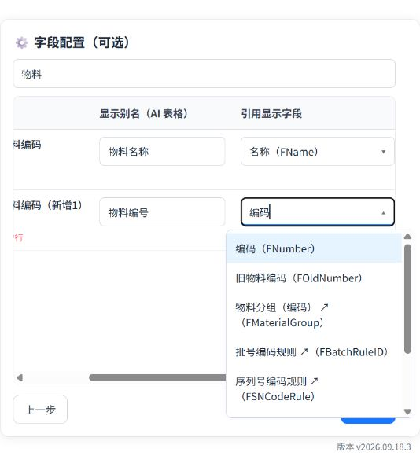
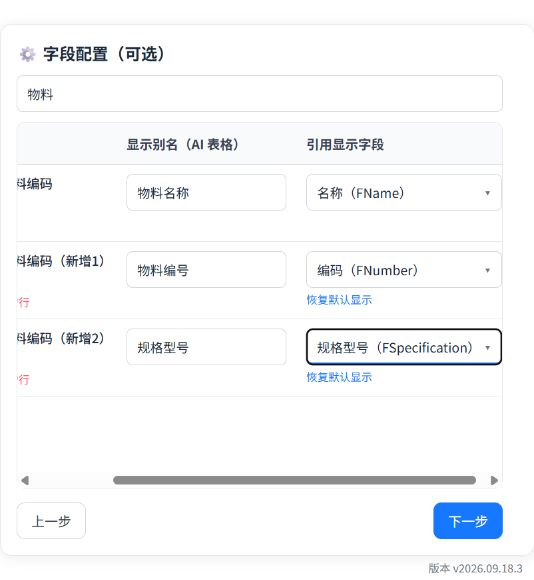
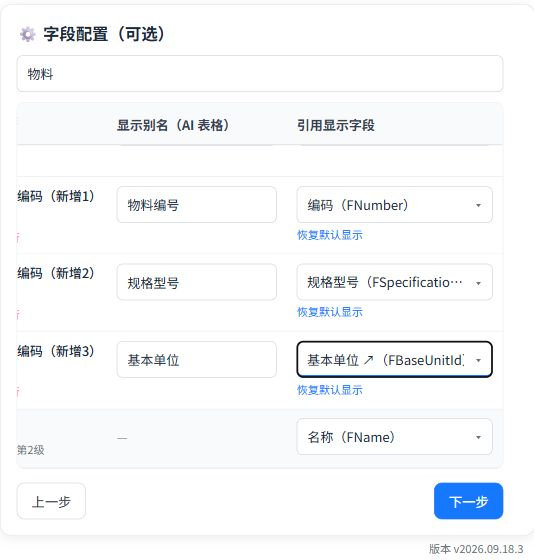

# 字段配置操作手册

在同步向导中设置输出字段别名，并从金蝶引用对象中选择名称、编号、规格型号等属性。本手册以收款单明细的物料字段为例，演示同一物料输出多列及多级引用。

截图来源  http://localhost:3000/   |   截图日期  2026年10月20日

## 1 进入字段配置

在已有连接中点击“同步数据”，选择表单并点击“下一步”。勾选要同步的明细表，可同时选择多个；仅需表头时选择“不同步明细，仅同步表头”。设置同步方式后点击“下一步”。

图1 选择明细范围后进入字段配置

## 2 查找字段与设置别名

在顶部搜索框输入字段名称或编码，例如“物料”，只显示匹配的字段配置行。此处搜索用于定位配置项，不会删除其他同步字段。

在“显示别名（AI 表格）”中输入输出列名，例如“物料名称”。别名只改变输出列名称；要改变取值内容，需要操作右侧的“引用显示字段”。清空别名可恢复默认列名。

图2 未修改时可直接跳过并保持原有同步方式

不需要自定义时，点击“跳过，保持默认”。普通字段右侧显示“原字段值”；引用字段会根据元数据提供下拉，通常默认使用名称 FName，已有特殊默认值按原规则保留。

窄窗口下，列表底部可横向滚动，查看来源字段、别名和引用显示字段。后续截图分别保留操作所在列。

## 3 搜索并选择引用显示字段

点击引用下拉，在下拉输入框内直接输入中文名称或字段编码，例如“编码”或“FNumber”。点击匹配项完成选择；也可以用方向键和回车选择，按 Esc 取消。只输入搜索词还不算选定。

图3 在引用下拉内输入编码并选择 FNumber

下拉候选项来自当前单据所引用对象的元数据。名称对应 FName，编码对应 FNumber，规格型号对应 FSpecification，实际可选项以当前账套元数据为准。带 ↗ 的选项表示还可以继续选择下一级属性。

## 4 同一来源新增多个输出列

保留原行的名称取值，并将别名设为“物料名称”。点击来源字段下的“＋新增行”，将新增行别名改为“物料编号”，引用显示字段选择“编码（FNumber）”。

再次点击“＋新增行”，将别名设为“规格型号”，引用显示字段选择“规格型号（FSpecification）”。这样同一个物料来源会输出三个独立列。

图4 同一物料分别输出名称 编号和规格型号

“新增行”增加的是同步输出列，不是在金蝶中创建物料或业务明细。“删除新增行”移除该额外输出列；“恢复默认显示”只恢复该行的引用取值，别名和新增行仍保留。

规格型号不再由系统强行补加。需要同步时，应从物料引用对象元数据中选择；若候选项不存在，请先确认所选来源及该引用对象的元数据。

## 5 用子行配置多级引用

以输出物料基本单位名称为例：新增一行并将别名设为“基本单位”，第一级选择“基本单位 ↗（FBaseUnitId）”。系统读取单位元数据后，在缩进子行中显示第二级下拉，选择“名称（FName）”。

图5 左侧为来源与子行  右侧为各级引用取值

完整取值为“物料 → 基本单位 → 名称”。子行表示引用层级，不会额外产生一列；要同时输出其他属性，应使用“＋新增行”。可继续选择带 ↗ 的字段，最多支持10级引用。

切换表单会清空字段配置；调整明细范围会移除不再适用的配置。修改范围后请重新核对新增列和引用路径。

## 6 核对配置并进入同步

点击“下一步”，等待配置校验完成后进入筛选和排序。可在筛选字段下拉中搜索刚设置的别名，例如“物料”，检查“物料名称”和“物料编号”是否出现。按业务需要设置条件与排序。

图6 配置后的别名可用于后续筛选

确认无误后点击“提交配置”，在钉钉实际运行环境完成保存及后续同步。本次手册截图演示到配置校验与筛选步骤，未执行钉钉提交或落表。

## 常见问题

没有引用下拉：先确认该字段是否属于引用类型。引用元数据加载失败时，检查连接与网络，按页面提示重试。

结果不是所需值：检查是否选中了候选项，以及最后一级是否为名称、编号等实际属性。别名相同不代表取值相同。
